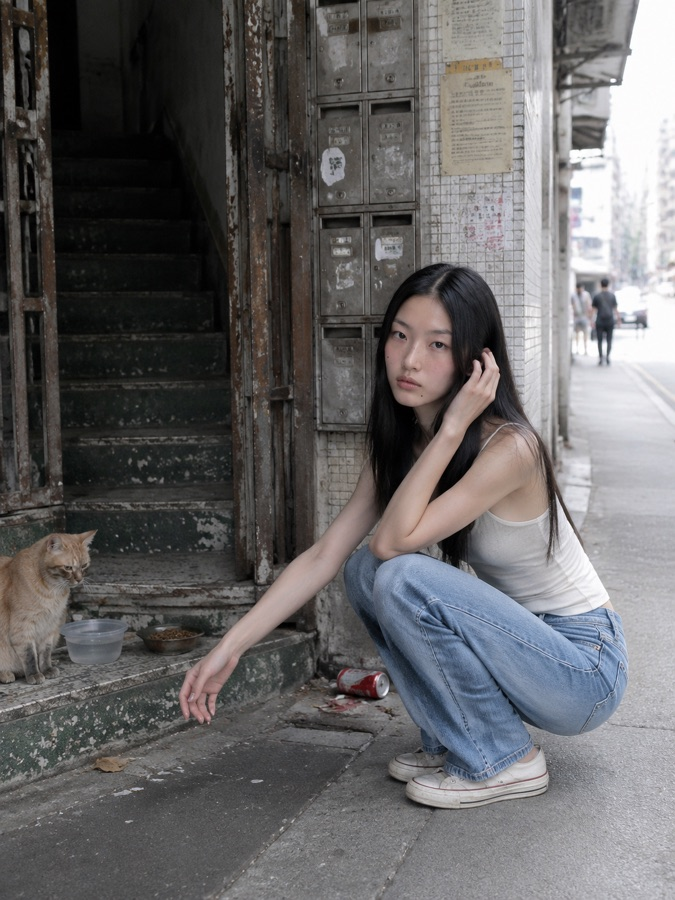
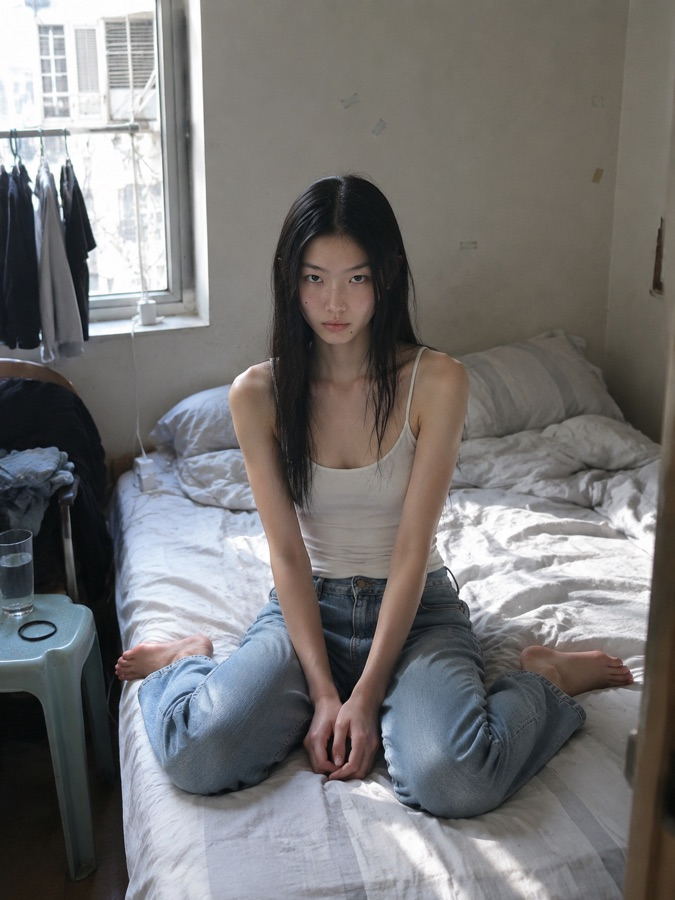
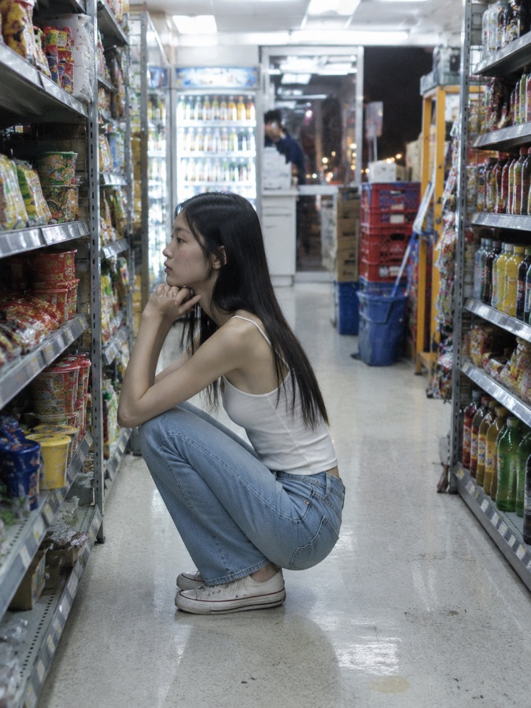
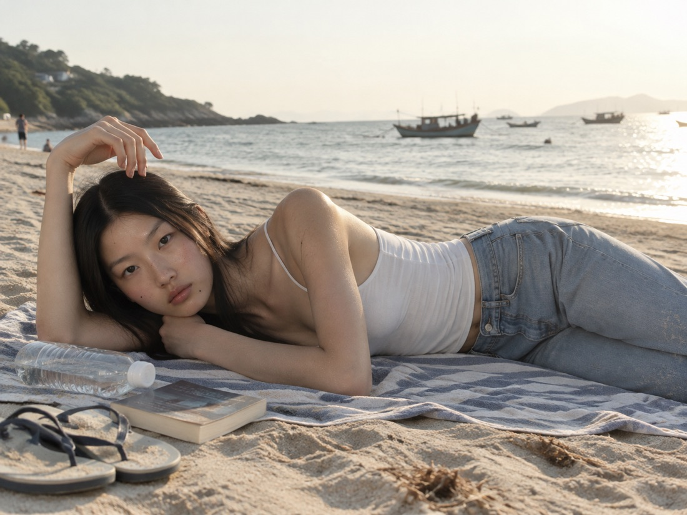
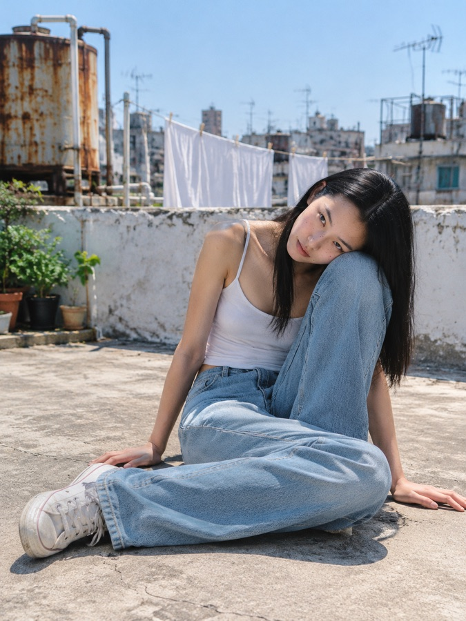
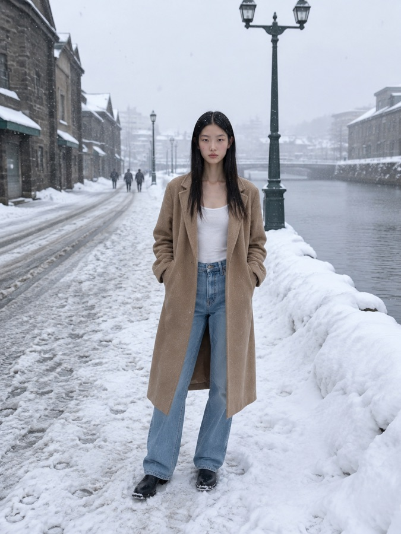
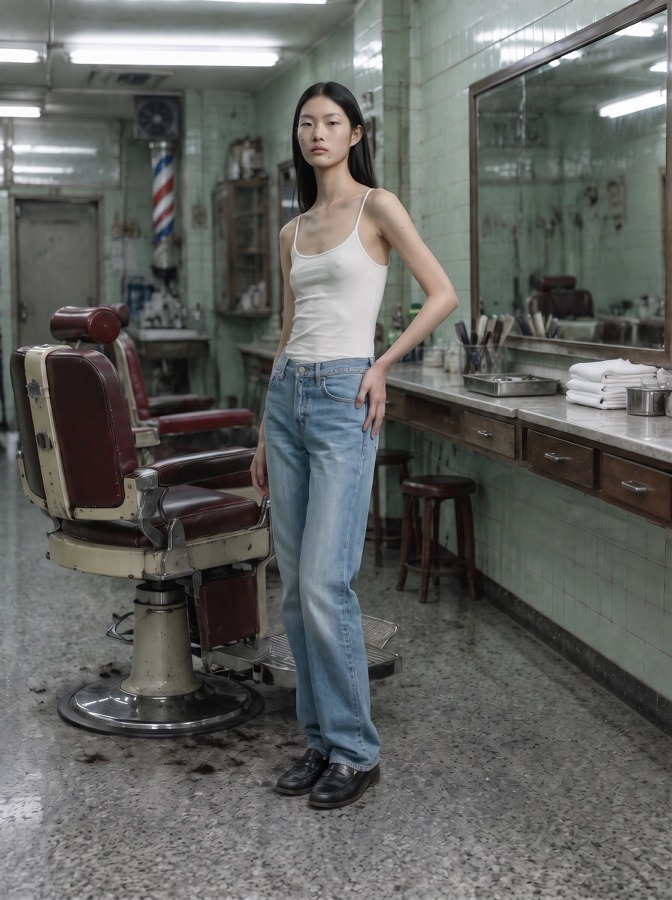
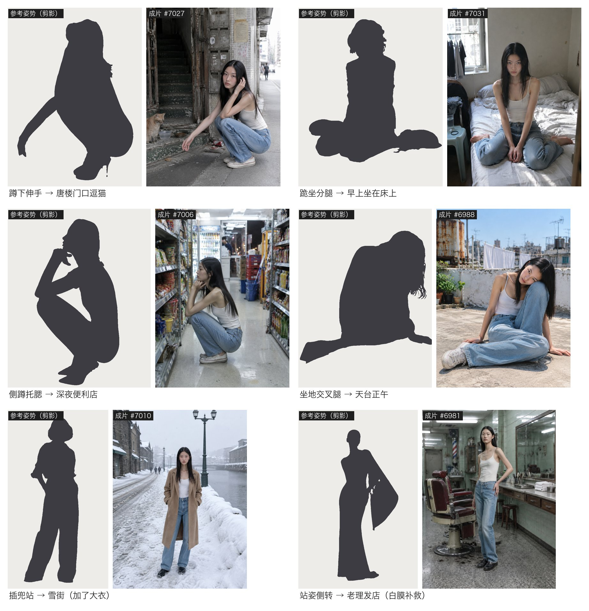
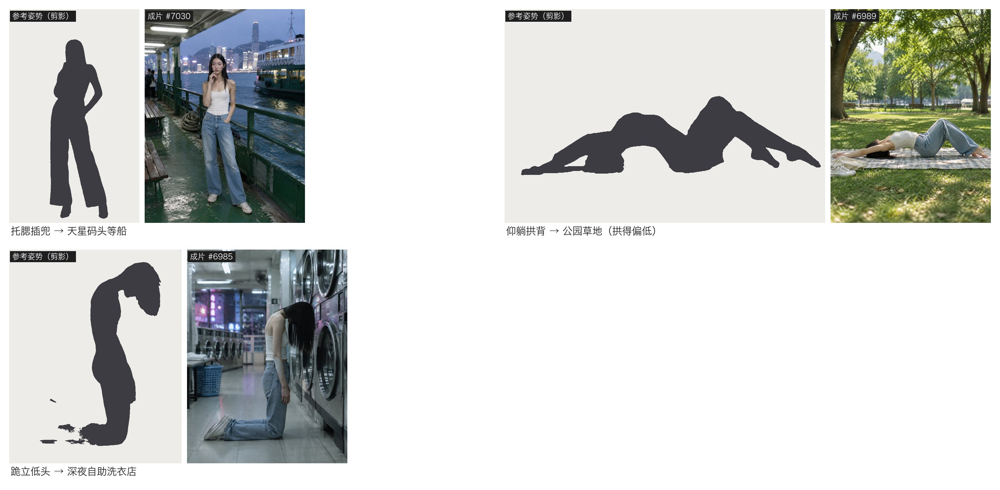

# pose-copy · 临摹姿势

给一张人物图、一张姿势参考图，说一个地方，出一张「这个人在这个地方摆成这个姿势」的照片。人还是那个人，衣服还是那身衣服，人和场景像同一次拍下来的，不是抠图贴上去的。

适合服装模特图、电商图、穿搭图：模特资产只拍一次，姿势和场景随便换。

<p align="center">
  
  
  
</p>
<p align="center">
  
</p>
<p align="center">
  
  
  
</p>

> 上面是同一个 AI 生成的模特，用不同的姿势参考图放进不同场景。每张 1 次生成（最后一张走了补救流程）。

### 姿势跟得准不准

左边是姿势参考图里的人（抠成剪影），右边是成片：





> 姿势参考图来自 Pinterest，是别人的照片，仓库里只放用 macOS Vision 抠出来的剪影，不放原图。拱背那张幅度偏小，是一步法的已知局限。

这是 [Claude Code](https://claude.com/claude-code) / Codex 的 skill：装好以后，直接用中文跟 agent 说你要什么就行。

## 安装

**Claude Code**
```bash
git clone https://github.com/linsahdkadsa/pose-copy.git ~/.claude/skills/pose-copy
```

**Codex**
```bash
git clone https://github.com/linsahdkadsa/pose-copy.git ~/.codex/skills/pose-copy
```

**还需要**：
- 一个能「图生图」的生图工具，下面任选一个：
  - **Codex 自带生图**：在 Codex 里直接能用，不用另外配置。比例靠提示词，出图约 1086×1448。
  - **apimart MCP**：skill 按它测得最多（GPT Image 2.5 主流程、Nano Banana Pro 补救流程），参数写法见 SKILL.md 第五节。
  - 其他能调 GPT Image 2.5 / Nano Banana Pro 的 MCP 或 API，照着第五节的表改参数名。
- 补救流程里的标关节脚本用 macOS 的 Vision 框架（`scripts/*.swift`，第一次运行会自己编译）。只走主流程用不到。
- 可选：banana 出图偏洋红时用的修色 skill repair-ai-image-quality，装在哪写进本 skill 根目录的 `local.md`（自己建，不进仓库）。

## 怎么用

装好后重启 agent，直接说：

- 「用这个模特（附人物图）照这张姿势（附参考图）在一家香港老式理发店里拍一张」
- 「让她摆成这张图的样子，场景换成深夜的便利店」
- 「这张姿势不对，再逼近一点」

agent 会：
1. 先放大看参考图，用「画面左 / 画面右」写清楚姿势，挑好具体地点、鞋、镜头，告诉你它挑了什么。
2. 1 张直接出；多张或要走补救流程，先报张数和花费，等你确认。
3. 出图后按验收清单逐条放大检查（姿势、没镜像、是不是同一个人、衣服鞋、比例、光、质感、残留、场景、像不像真照片），哪条没过会直接说。

## 两条路

| 情况 | 走哪条 |
|---|---|
| 人物 + 姿势参考 + 想要的场景，要新拍 | **一步法**（主）：GPT Image 2.5 一次生成人 + 场景 + 姿势，约 $0.03 一张 |
| 一步法姿势跟不准，或已有一张原图只想换姿势 | **白膜流程**（补救）：去人底板 → 白膜照参考摆姿势 → 标关节叠骨架 → 把白膜换回真人，约 $0.09～0.15 |

为什么人和场景要一次生成：先出空场景再把人放进去，人永远像贴上去的。一次生成时光、比例、阴影是一起算出来的。

## 测试过的

- 一步法一次就跟上：站、托腮插兜、蹲、侧蹲托腮、跪坐、跪立低头、侧坐后撑、坐地交叉腿、趴着翘腿、侧躺。
- 一步法跟不准：站姿身体 3/4 侧转、明显顶胯（会被拉回正面）；仰躺拱背这类柔韧动作幅度会变小。侧转那张走白膜流程后对上了（上面最后一张）。
- 真人实拍全身照当模特资产时，脸会漂成另一个人；再加一张脸部特写当第 3 张参考就锁住了。
- 真实感：公共场所别写「只有一个人」（会空得像布景），改成远处有几个虚化的路人；镜头写「朋友随手拍、相机直出、不调色」，场景写两三处生活痕迹。3 组对照都明显更像真照片。

细节和每条规则的来由在 `references/` 里：

- `一步法提示词.md`：模板、各种光的写法、按姿势换机位、姿势例句、真实感那几句
- `白膜流程.md`：补救流程每一步的提示词
- `验收清单.md`：出图后逐条检查
- `踩过的坑.md`：测试里踩过的坑

## License

MIT
