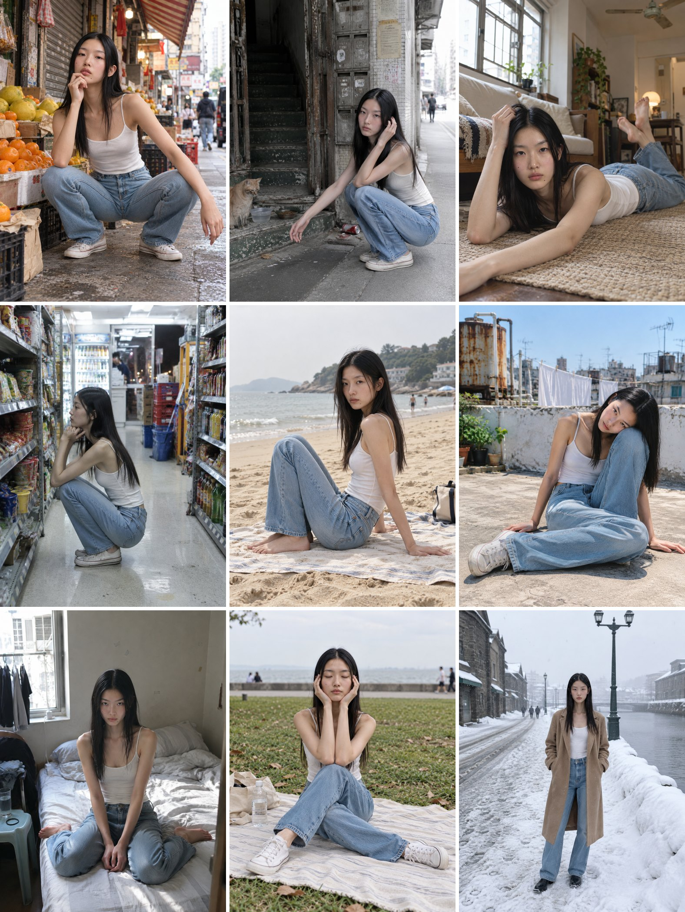
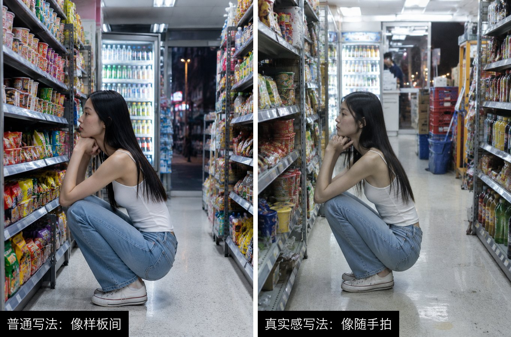
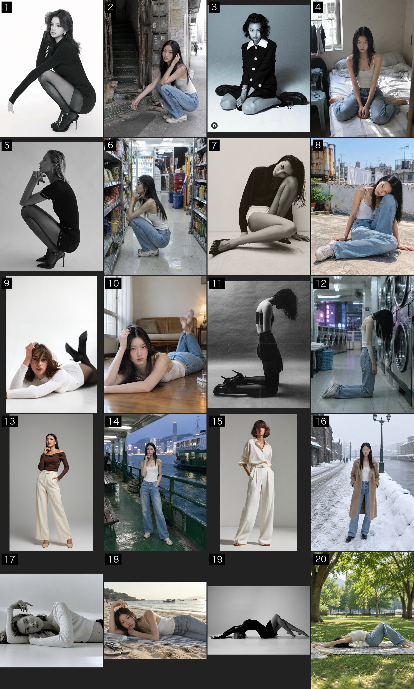
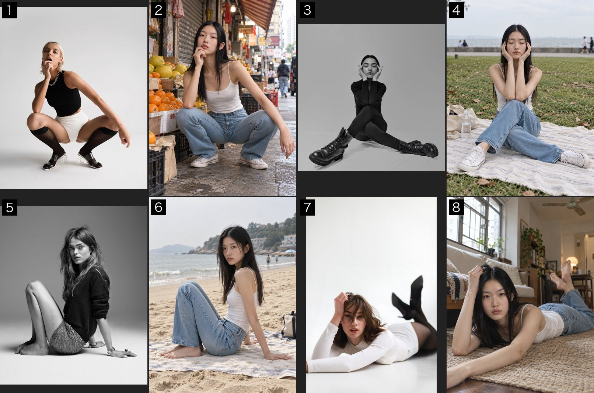
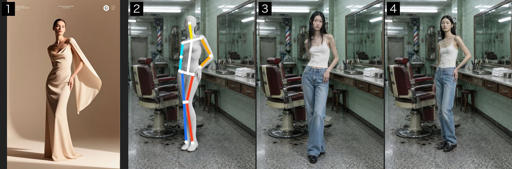

<h1 align="center">pose-copy · 临摹姿势</h1>

<p align="center"><b>一张模特图 + 一张姿势参考 + 一句地点 → 她在那里摆成那个姿势的照片</b><br>
人还是那个人，衣服还是那身衣服，人和场景是一起拍出来的，不是抠图贴上去的。</p>

<p align="center">
  <a href="#安装">安装</a> ·
  <a href="#怎么用">怎么用</a> ·
  <a href="#姿势跟得准不准">效果对比</a> ·
  <a href="#为什么不像贴图">为什么不像贴图</a>
</p>



<p align="center"><sub>同一个 AI 生成的模特，9 张姿势参考，9 个香港 / 小樽的场景。每张一次生成，没有修图。</sub></p>

适合服装模特图、电商图、穿搭图：模特资产只拍一次，姿势和场景随便换。这是 [Claude Code](https://claude.com/claude-code) / Codex 的 skill，装好以后直接用中文跟 agent 说。

---

## 为什么不像贴图

很多「换场景」的做法是先出一张空场景，再把人放进去，结果人永远像贴在背景上：光的方向不对、脚下没有影子、人比墙还亮。

pose-copy 让人和场景在**同一次生成**里出来，提示词里把场景写在最前面，人「在这个地方做这个动作」，并且：

- **光只用场景里的光**：人不比场景里最亮的东西亮，白衣服和墙是同一种白，脚下有接触阴影。
- **镜头像真人拍的**：50mm、3～4 米外、蹲坐时把机位放低，不用广角近拍（腿不会被拉长）。
- **场景有人气**：写两三处生活痕迹，公共场所远处有几个虚化的路人；「相机直出、不调色」，没有电影调色和 HDR 感。

同一个人、同一个姿势、同一个便利店，只改了真实感那几句：



---

## 姿势跟得准不准

每两格一组：**单数格是姿势参考，右边的双数格是成片**。场景是按姿势挑的，让动作说得通：蹲下伸手 → 唐楼门口逗猫，跪坐分腿 → 早上坐在床上，侧坐后撑 → 沙滩上歇脚。



用 Codex 自带生图跑的（不用任何外部生图服务）：



一步法跟不准的姿势（比如站着身体侧转 45°，会被拉回正面）走白膜流程补救：① 参考 ② 白色人台照参考摆好、叠上分色骨架 ③ 一步法出的 ④ 补救后



> 姿势参考图来自 Pinterest，版权归原作者，这里只用来对比姿势、不作商用。如有侵权请提 issue，会马上删除。

---

## 安装

**Claude Code**
```bash
git clone https://github.com/linsahdkadsa/pose-copy.git ~/.claude/skills/pose-copy
```

**Codex**
```bash
git clone https://github.com/linsahdkadsa/pose-copy.git ~/.codex/skills/pose-copy
```

**生图工具**（能「图生图」的，任选一个）：

| 工具 | 说明 |
|---|---|
| Codex 自带生图 | 在 Codex 里直接能用，不用配置。比例靠提示词，出图约 1086×1448 |
| 其他 MCP / API | 能调 GPT Image 2.5 或 Nano Banana Pro 就行，参数名照 SKILL.md 第五节改 |

可选：补救流程的标关节脚本用 macOS Vision（`scripts/*.swift`，第一次运行自己编译）；banana 改图偏洋红时用修色 skill repair-ai-image-quality，路径写进根目录的 `local.md`（自己建，不进仓库）。

## 怎么用

装好后重启 agent，直接说：

- 「用这个模特（附人物图）照这张姿势（附参考图）在一家香港老式理发店里拍一张」
- 「让她摆成这张图的样子，场景换成深夜的便利店」
- 「这张头转反了，只改一下头」

agent 会：

1. 放大看参考图，用「画面左 / 画面右」写清楚姿势，挑好具体地点、鞋、镜头，告诉你它挑了什么。
2. 1 张直接出；多张或要补救，先报张数和花费。
3. 出图后按 10 条验收清单放大检查：姿势、没镜像、同一个人、衣服鞋、比例、光、质感、残留、场景、像不像真照片。哪条没过直接说。

## 三条路

| 情况 | 走哪条 |
|---|---|
| 人物 + 姿势参考 + 想要的场景 | **一步法**（主）：一次生成人 + 场景 + 姿势 |
| 身体都对，只有头转反或视线看反 | **局部改头**：在成片上只改头，场景一点不动 |
| 一步法姿势跟不准，或已有原图只想换姿势 | **白膜流程**：去人底板 → 白膜摆姿势 → 叠骨架 → 换回真人 |

## 测试过的

- 一步法一次跟上：站、托腮插兜、蹲、侧蹲托腮、宽蹲、跪坐、跪立低头、侧坐后撑、坐地交叉腿、趴着翘腿、侧躺。
- 跟不准：站姿 3/4 侧转、明显顶胯（被拉回正面）；仰躺拱背幅度会变小。
- 真人实拍全身照当资产，脸会漂成另一个人；再加一张脸部特写就锁住。
- Codex 自带生图跑 10 组，姿势对上 8 组；视线看反那张用「局部改头」修好。

规则和来由都在 `references/`：`一步法提示词.md`（模板、光、机位、姿势例句、真实感）、`白膜流程.md`（补救和局部改头）、`验收清单.md`、`踩过的坑.md`。

## License

MIT
